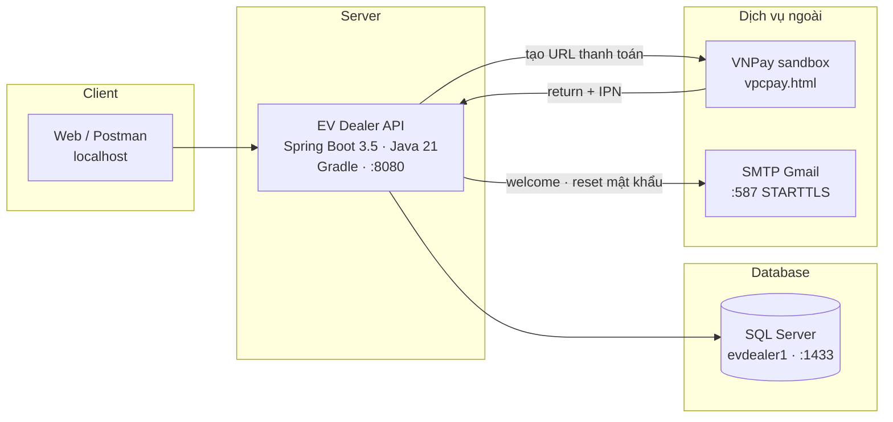
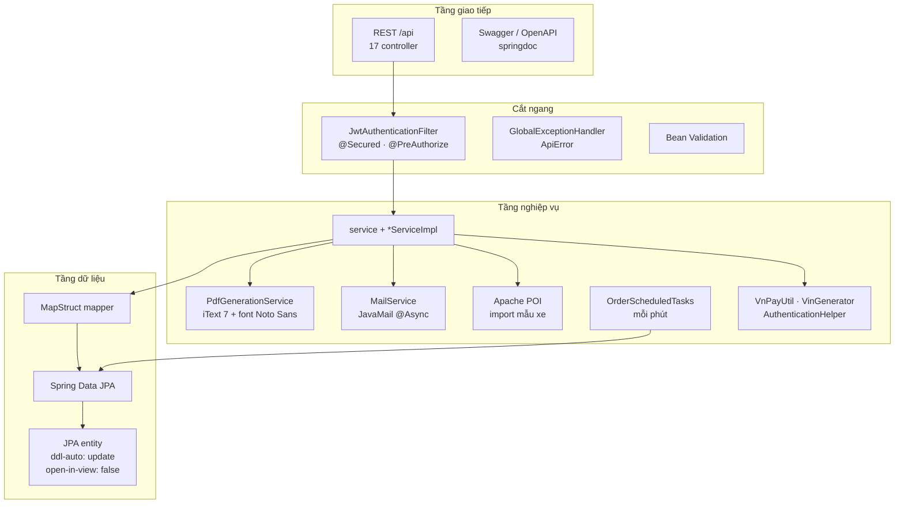
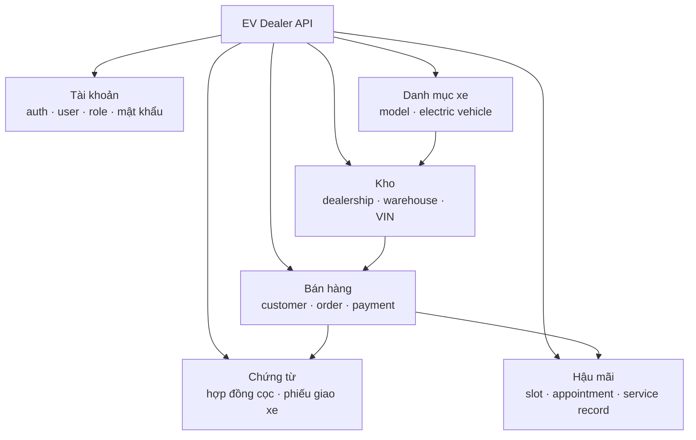
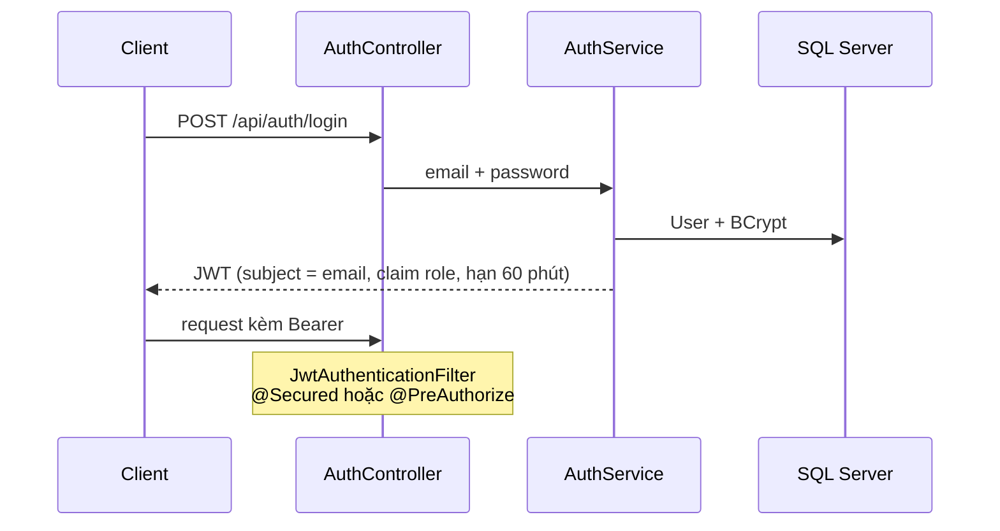
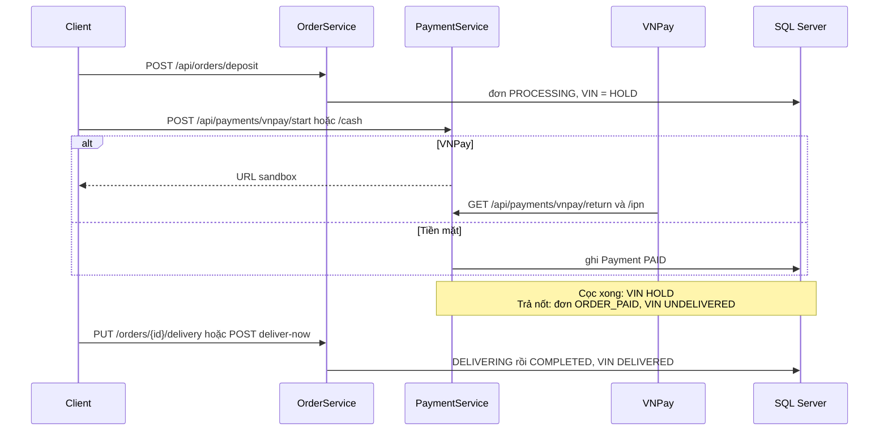
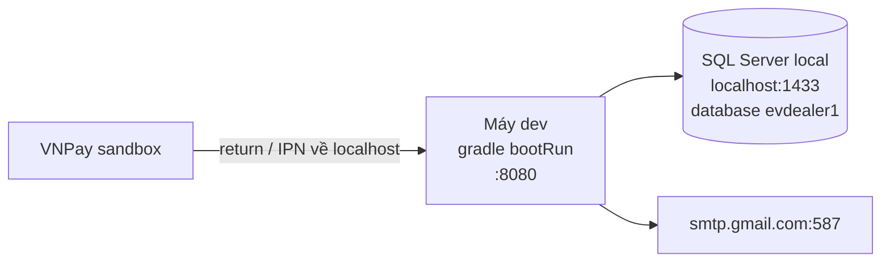

# Sơ đồ kiến trúc — EV Dealer System

Backend quản lý đại lý xe điện (đồ án SWP391). Hệ thống theo dõi mẫu xe, số VIN trong kho, khách hàng, đơn cọc và thanh toán, giao xe, lịch lái thử / bảo dưỡng. Repo này là **một API monolith** (không có frontend trong source).

Tài liệu này tóm tắt kiến trúc đang chạy trong code, không phải bản vẽ UML có sẵn trong repo.

## 1. Bối cảnh hệ thống

Ba tầng: client → API Spring Boot → SQL Server. Thanh toán đi qua VNPay sandbox. Email đi qua SMTP Gmail. PDF hợp đồng và phiếu giao xe được sinh trong process.

Không có reverse proxy, Docker hay WebSocket trong repo. Ảnh xe chỉ lưu `image_url` trên entity, API không nhận file ảnh.

## 2. Kiến trúc phân lớp trong API

Một process Spring Boot, stateless. Request đi từ controller xuống service, MapStruct, repository, entity. Không có message broker.

Luồng một request đã đăng nhập:

1. `JwtAuthenticationFilter` đọc `Authorization: Bearer`, `JwtService` lấy email (subject), `JpaUserDetailsService` nạp user.
2. Method security (`@Secured` hoặc `@PreAuthorize`) kiểm tra role trên một số controller. Nhiều API chỉ yêu cầu đã đăng nhập; phạm vi đại lý được kiểm tra trong service.
3. Controller nhận DTO request, gọi interface trong `service`.
4. `*ServiceImpl` áp rule nghiệp vụ, ghi entity qua repository.
5. MapStruct trả DTO response.
6. Lỗi đi qua `GlobalExceptionHandler` và body `ApiError`.

Phiên HTTP là **stateless** (`SessionCreationPolicy.STATELESS`). CSRF tắt vì client gửi JWT.

Endpoint công khai: `/api/auth/**` (đăng ký, đăng nhập), Swagger (`/swagger-ui/**`, `/v3/api-docs/**`), callback VNPay `/api/payments/vnpay/**`, và preflight `OPTIONS`. `VnpayController` (`/api/vnpay`) đang comment, không đăng ký bean.

`/api/password/forgot` và `/api/password/reset` **không** nằm trong danh sách public, nên filter hiện tại vẫn đòi JWT.

## 3. Nhóm nghiệp vụ

Các module nằm chung một codebase, tách theo controller và service, không phải microservice.

| Nhóm | Việc chính | Điểm vào API |
|---|---|---|
| Tài khoản | Đăng ký, đăng nhập JWT, CRUD user, role, quên mật khẩu qua email | `/api/auth`, `/api/users`, `/api/roles`, `/api/password` |
| Danh mục xe | Mẫu xe, cấu hình xe điện, import Excel | `/api/models`, `/api/electric-vehicles` |
| Kho | Đại lý, kho, tồn theo model, chuyển kho, VIN | `/api/dealerships`, `/api/warehouses` |
| Bán hàng | Khách, đơn cọc, trả nốt, giao xe | `/api/customers`, `/api/orders` |
| Thanh toán | Tiền mặt hoặc VNPay (cọc / phần còn lại), lịch sử | `/api/payments` |
| Chứng từ | PDF hợp đồng đặt cọc và phiếu giao xe | `/api/contracts`, `/api/orders/{id}/delivery-slip` |
| Hậu mãi | Khung giờ, lịch hẹn lái thử / bảo dưỡng, phiếu dịch vụ | `/api/slots`, `/api/appointments`, `/api/service-entitys`, `/api/service-records` |

Role lưu trong bảng `roles`, tên kèm prefix: `ROLE_USER`, `ROLE_ADMIN`, `ROLE_EVMSTAFF`, `ROLE_EVMMANAGER`. JWT nhét claim `role`.

- `ROLE_ADMIN`: CRUD user, model, xe; bỏ qua kiểm tra đại lý khi bán xe và xem kho.
- `ROLE_EVMSTAFF`: xem model và xe; bán trong đại lý mình thuộc.
- `ROLE_EVMMANAGER`: role có trong seed; phân quyền method chủ yếu chưa gắn role này.
- `ROLE_USER`: role mặc định lúc đăng ký.

Phạm vi dữ liệu: nhân viên không phải admin chỉ bán VIN thuộc đúng `dealership` của mình (`OrderServiceImpl`). Kho cũng lọc theo role trong `WarehouseServiceImpl`.

## 4. Dữ liệu

SQL Server, database `evdealer1`. Hibernate `ddl-auto: update` cập nhật bảng lúc khởi động. Script tạo bảng và seed nằm ở `src/main/resources/db/` (`evdealer_table.sql`, `evdealer_key.sql`, `evdealer_data.sql`), chạy tay, không gắn vào startup.

| Nhóm | Bảng / entity |
|---|---|
| Tổ chức | `Role`, `User`, `Dealership`, `PasswordResetToken` |
| Sản phẩm | `Model`, `ElectricVehicle` |
| Kho | `Warehouse`, `WarehouseStock`, `VehicleSerial` |
| Bán hàng | `Customer`, `Order`, `Payment` |
| Hậu mãi | `Slot`, `Appointment`, `ServiceEntity`, `ServiceRecord` |

Trạng thái đơn (`OrderStatus`): `PROCESSING` → `ORDER_PAID` → `DELIVERING` → `COMPLETED`, hoặc `CANCELED`.

Trạng thái VIN (`VehicleStatus`): `AVAILABLE`, `HOLD`, `UNDELIVERED`, `DELIVERING`, `DELIVERED`, `SOLD_OUT`.

Thanh toán: `PaymentMethod` là `CASH` hoặc `VNPAY`; `PaymentPurpose` là `DEPOSIT` hoặc `REMAINING`. `OrderPaymentStatus` theo dõi phần tiền: `UNPAID`, `DEPOSIT_PAID`, `PAID`, `OVERDUE`.

## 5. Luồng cắt ngang

### Xác thực

Mật khẩu hash bằng BCrypt. JWT ký HMAC-SHA256 (`jjwt` 0.11.5). Hạn đọc từ `jwt.exp-minutes` (mặc định 60).

Quên mật khẩu: `PasswordService` tạo `PasswordResetToken`, `MailService.sendResetPasswordEmail` gửi link (method đánh `@Async`). Tạo user admin / staff cũng gửi email chào mừng qua SMTP.

### Đơn hàng và thanh toán

`VNPAYService` ký query theo `vnpay.tmnCode`, `vnpay.hashSecret`, `vnpay.url`. Return URL và IPN trỏ `http://localhost:8080/api/payments/vnpay/return|ipn`. Callback public, xác thực bằng chữ ký VNPay trong service.

### Chứng từ PDF

`PdfGenerationServiceImpl` (iText 7) vẽ hợp đồng đặt cọc và phiếu giao xe, nhúng font `src/main/resources/fonts/NotoSans-*.ttf`. Thông tin bên bán đọc từ `evdealer.company.*`. API trả `application/pdf`.

### Import Excel

`POST /api/electric-vehicles/import-vehicle-type-excel` đọc workbook bằng Apache POI và tạo `ElectricVehicle` (status mặc định `AVAILABLE` nếu ô trạng thái không hợp lệ).

### Job định kỳ

`@EnableScheduling` trên `EvdealersystemApplication`. Một job:

| Job | Lịch | Việc |
|---|---|---|
| `autoCompleteDeliveringOrders` | `0 * * * * ?` (mỗi phút) | Đơn `DELIVERING` có `deliveryDate` ≤ hôm nay → đơn `COMPLETED`, VIN `DELIVERED`, xóa `holdUntil` |

Comment trong code nói 01:00 mỗi ngày; cron đang chạy mỗi phút. Múi giờ job là giờ JVM (`LocalDate.now()`). Jackson và Hibernate đặt `UTC`.

## 6. Triển khai

Không có `Dockerfile` hay workflow CI trong repo. Chạy local bằng Gradle, JDK 21.

Cấu hình nằm thẳng trong `src/main/resources/application.properties` (không tách profile, không đọc `.env`):

| Nhóm key | Việc |
|---|---|
| `spring.datasource.*` | JDBC SQL Server, user `sa`, pool Hikari tối đa 10 |
| `jwt.secret`, `jwt.exp-minutes` | Ký và hạn JWT |
| `vnpay.*` | Sandbox VNPay |
| `spring.mail.*` | SMTP Gmail |
| `evdealer.company.*` | Thông tin in trên PDF |

`MailConfig` trong package `config` đang comment; mail dùng auto-config của `spring-boot-starter-mail`.

## 7. Ràng buộc của kiến trúc hiện tại

- Một deployable: API, cron, sinh PDF và gửi mail cùng một JVM. Không có broker, cache hay hàng đợi ngoài.
- Schema vừa có script SQL tay, vừa để Hibernate `ddl-auto: update`. Hai nguồn có thể lệch nhau.
- Phân quyền không đều: catalog và user gắn `@Secured` / `@PreAuthorize`; đơn, thanh toán, kho, lịch hẹn chủ yếu chỉ cần đã đăng nhập, rồi service tự so sánh đại lý.
- Quên mật khẩu và đặt lại mật khẩu chưa được `permitAll`, trong khi login mới là endpoint public.
- Callback VNPay và cron giả định một instance trên `localhost`. IPN sandbox không tới được máy dev nếu không có tunnel.
- `Thymeleaf` có trong `build.gradle` nhưng không có template nào dùng nó. PDF vẽ bằng iText.
- `group` trong Gradle vẫn để `HeathCareSystem.example` — dấu vết project gốc, không ảnh hưởng runtime.
