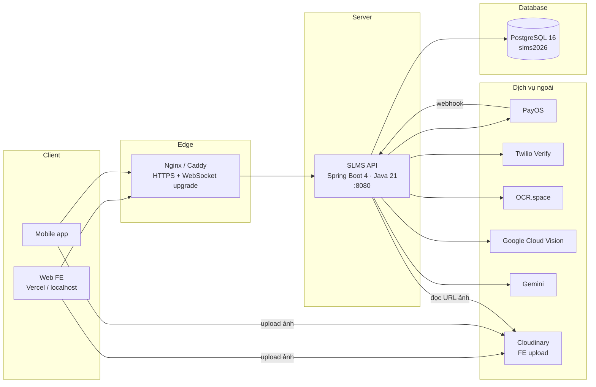
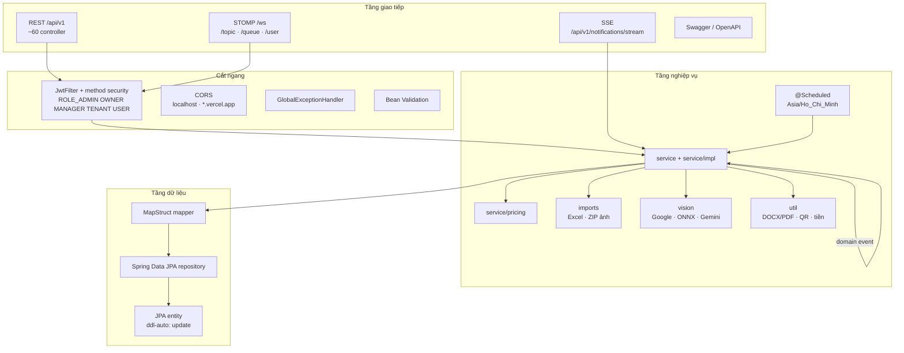
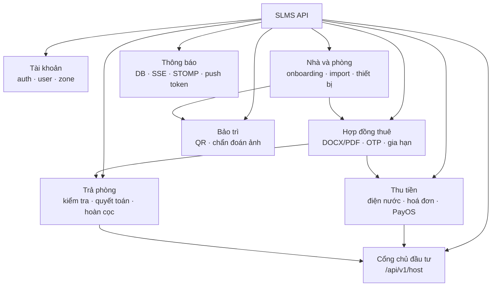
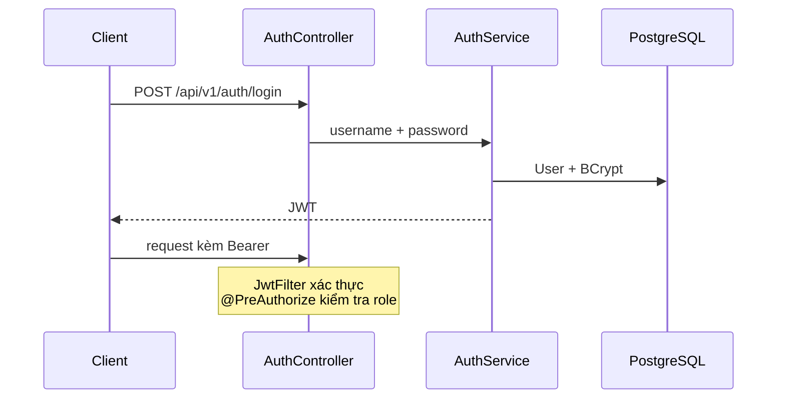
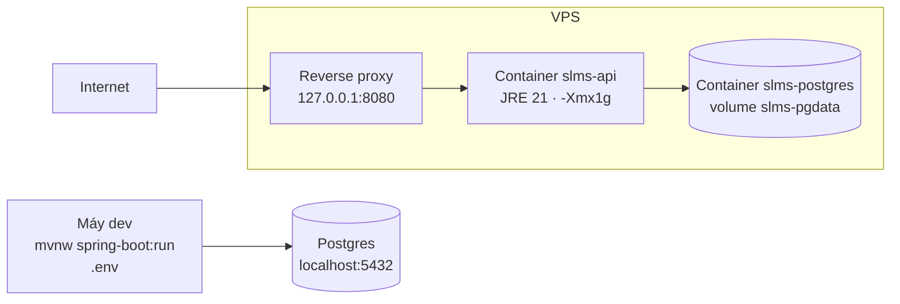

# Sơ đồ kiến trúc — SLMS2026

Backend **Sub-Leasing Management System** (đồ án SEP490). Công ty thuê nhà nguyên căn, cải tạo, rồi cho thuê lại theo phòng hoặc nguyên căn. Repo này là **một API monolith** (không có frontend trong source).

Tài liệu này tóm tắt kiến trúc đang chạy trong code, không phải bản vẽ UML có sẵn trong repo.

## 1. Bối cảnh hệ thống

Ba tầng: client → API Spring Boot → PostgreSQL. Ảnh do frontend đẩy lên Cloudinary; backend chỉ nhận URL. Thanh toán, OTP và nhận diện ảnh đi ra dịch vụ ngoài.

## 2. Kiến trúc phân lớp trong API

Một process Spring Boot, stateless. Request đi thẳng từ controller xuống service, repository, entity. Không có message broker riêng.

Luồng một request đã đăng nhập:

1. `JwtFilter` đọc `Authorization: Bearer`, nạp `CustomUserDetails`.
2. `@PreAuthorize` trên controller kiểm tra role.
3. Controller nhận DTO request, gọi interface trong `service`.
4. `service/impl` áp rule nghiệp vụ, ghi entity qua repository.
5. MapStruct (và mapper thủ công) trả DTO response.
6. Lỗi nghiệp vụ đi qua `GlobalExceptionHandler`.

Phiên HTTP là **stateless** (`SessionCreationPolicy.STATELESS`). CSRF tắt vì client gửi JWT.

Endpoint công khai (không cần token): `/api/v1/auth/**`, đăng ký user, webhook PayOS, `GET /api/v1/public/properties/**`, Swagger, file tĩnh `/uploads/properties/**`. WebSocket endpoint `/ws` mở ở tầng HTTP, nhưng frame `CONNECT` bắt buộc header Bearer.

## 3. Nhóm nghiệp vụ

Các module nằm chung một codebase, tách theo controller và service, không phải microservice.

| Nhóm | Việc chính | Điểm vào API |
|---|---|---|
| Tài khoản | Đăng nhập JWT, hồ sơ, khu vực, phân công manager | `/api/v1/auth`, `/api/v1/user`, `/api/v2/zones` |
| Nhà / phòng | Nhà nháp, phòng, thiết bị, QR, import Excel và ZIP ảnh, duyệt giá | `/api/v1/properties`, `/api/v1/import`, `/api/v1/public/properties` |
| Hợp đồng | Nháp, xuất DOCX/PDF, ký OTP hai phía, gia hạn, chấm dứt | `/api/v1/tenant-contracts`, `/api/v1/properties/{id}` |
| Thu tiền | Chỉ số đồng hồ, khoá/mở khoá, hoá đơn, khiếu nại, PayOS | `/api/v1/ocr`, manager/admin billing, webhook `/api/v1/payos` |
| Bảo trì | Yêu cầu, QR có mặt, chẩn đoán, sửa, bàn giao | maintenance controllers, `/api/v1/vision` |
| Trả phòng | Yêu cầu, duyệt, kiểm tra hư hỏng, quyết toán, hoàn cọc | `/api/v1/checkout-requests` |
| Chủ đầu tư | Dashboard, dòng tiền, P&L, thông báo host, hoàn cọc | `/api/v1/host` |
| Thông báo | Hộp thư, SSE, STOMP, lưu push token | `/api/v1/notifications`, `/ws` |

Role: `ADMIN` cấu hình và duyệt; `OWNER` (host) duyệt giá và xem tài chính; `MANAGER` vận hành theo khu; `TENANT` hợp đồng, thanh toán, bảo trì, trả phòng; `USER` xem nhà trống và đăng ký xem phòng.

`MasterLeaseController` và `HostExpenseController` hiện **không** đăng ký `@RestController`. Cổng host đang gom ở `HostController`.

## 4. Dữ liệu

PostgreSQL, Hibernate `ddl-auto: update` tạo và cập nhật bảng lúc khởi động. `DataSeeder` nạp khu vực, danh mục và tài khoản demo. Script SQL trong `scripts/` và `src/main/resources/db` dùng cho seed demo và migration tay.

Nhóm entity chính:

| Nhóm | Entity tiêu biểu |
|---|---|
| Tổ chức | `User`, `Owner`, `Zone`, `ZoneManager`, `OperationManagement` |
| Bất động sản | `Property`, `Room`, `RoomPriceHistory`, `Equipment`, `EquipmentCatalog`, `RenovationSession`, `RenovationLine` |
| Thuê | `MasterLease`, `InboundContract`, `Tenant`, `TenantContract`, `HouseholdMember`, `ExtensionRequest` |
| Tiền | `Invoice`, `TenantInvoice`, `UtilityBill`, `UtilityInvoice`, `TenantPayment`, `TenantPendingCharge`, `Expense`, `HostExpense`, `PricingConfig`, `DepreciationResult` |
| Vận hành | `MeterReading`, `MaintenanceRequest`, `CheckoutRequest`, `CheckoutInspection`, `CheckoutSettlement` |
| Phụ | `Notification`, `OtpVerification`, `PropertyViewingLead`, `UserPushToken` |

## 5. Luồng cắt ngang

### Xác thực

Mật khẩu hash bằng BCrypt. JWT ký HMAC (`jjwt`), hạn mặc định 10 ngày.

### Thanh toán

Client tạo đơn PayOS qua service billing. PayOS gọi lại `POST /api/v1/payos/webhook` (public). Khi hoá đơn được đánh dấu đã trả, `InvoicePaidEvent` kích hoạt listener trong process (không qua hàng đợi ngoài).

### Hợp đồng và OTP

Template DOCX trong `src/main/resources/templates/contract`. Apache POI + XDocReport render DOCX rồi chuyển PDF. Kích hoạt hợp đồng dùng OTP Twilio Verify (`OtpService` / `TwilioService`).

### Ảnh và nhận diện

Frontend upload Cloudinary, gửi URL `https` (host cho phép mặc định `res.cloudinary.com`).

- Chỉ số đồng hồ: `OcrService` gọi OCR.space.
- Nhãn thiết bị: `VisionServiceImpl` chọn `google`, `local` (ONNX MobileNetV3 trong JVM) hoặc `auto` (Google trước, lỗi thì local).
- Mô tả hiện trạng phòng: Gemini.

### Realtime

| Kênh | Cách dùng |
|---|---|
| STOMP `/ws` | Broker đơn giản trong process. Đích `/topic`, `/queue`, user `/user`. `RealtimeEventServiceImpl` đẩy sự kiện (billing, vận hành). |
| SSE | `Notification` vừa insert thì `NotificationListener` gọi `SseNotificationService` đẩy tới user đang subscribe. |
| Push token | `UserPushToken` lưu token thiết bị; gửi push nằm ở `PushNotificationService`. |

Broker STOMP là in-memory. Nhiều instance API sẽ không chia sẻ socket với nhau.

### Job định kỳ

Tất cả cron dùng múi `Asia/Ho_Chi_Minh`, chạy trong cùng process:

| Job | Lịch | Việc |
|---|---|---|
| Billing sweep | 08:00, bù lúc startup | Phát hành / nhắc / quá hạn hoá đơn |
| Billing mốc đêm | 00:05, 00:10 | Chu kỳ tiền nhà |
| Contract lifecycle | 00:00, 00:10, 07:15, 08:05 | Hết hạn, promote nháp, nhắc đón khách, huỷ no-show |
| Checkout | 00:00, 00:15, 08:30 | Vòng đời yêu cầu trả phòng |
| Nhắc chỉ số | 08:00, 18:00, 20:00 | Nhắc manager chụp đồng hồ |

## 6. Triển khai

`Dockerfile` build hai giai đoạn: Maven đóng JAR, image chạy `eclipse-temurin:21-jre`. Biến môi trường bắt buộc: `DB_URL`, `DB_USERNAME`, `DB_PASSWORD`, `JWT_SECRET`. Thiếu key PayOS, Twilio, OCR, Vision, Gemini thì app vẫn lên; tính năng đó lỗi lúc gọi.

Ảnh nhà upload thẳng vào API nằm ở `uploads/properties` (có thể đổi bằng `PROPERTY_IMAGES_DIR`). Thư mục này nằm trong container, không có volume riêng trong lệnh `docker run` của README.

## 7. Ràng buộc của kiến trúc hiện tại

- Một deployable: API, cron, WebSocket, SSE và ONNX cùng một JVM.
- Schema do Hibernate cập nhật lúc chạy, không có pipeline migration phiên bản hoá trong luồng khởi động chính.
- WebSocket và SSE giữ trạng thái trong RAM của một instance.
- Phân quyền chủ yếu ở `@PreAuthorize` trên controller, kèm kiểm tra phạm vi nhà/khu trong service (`PropertyAccessService`).
